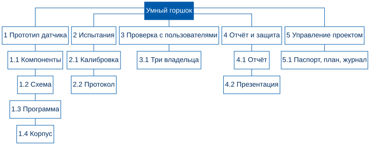
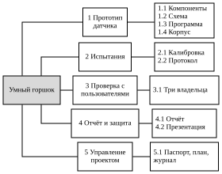

<!-- Проба стека: фрагмент методических указаний занятия 6, не текст издания. -->

## Зачем нужна WBS и где она стоит в проекте

Выбранная ветвь дерева целей — это желаемое состояние («влажность на глубине корней видна»), а не работа. По ней нельзя назначить ответственного, оценить срок и посчитать стоимость. Следующий шаг — разложить выбранное содержание на части, которые можно сделать, проверить и оценить. Такое разложение называется **иерархической структурой работ** (WBS, work breakdown structure).

::: {.callout-note title="Определение"}
Иерархическая структура работ — иерархическая декомпозиция всего объёма работ, который команда должна выполнить, чтобы достичь целей проекта и получить требуемые результаты [@pmbok7].
:::

**Правило 100 %.** WBS включает всю работу, входящую в содержание проекта, и ничего сверх него [@pmi-wbs]. Термины проектного управления на русском языке приведены в стандарте [@gost21500].

## Пример: умный горшок

Дерево работ умного горшка показано на рис. [-@fig-wbs], пакеты работ и то, что по ним предъявляется, — в таблице [-@tbl-pakety].

::: {.content-visible when-format="html"}
{#fig-wbs}
:::

::: {.content-visible when-format="pdf"}
{#fig-wbs}
:::

::: {.content-visible when-format="docx"}
{#fig-wbs}
:::

::: {.content-visible when-format="typst"}
{#fig-wbs}
:::

| Код | Элемент WBS | Что предъявляем |
|---|---|---|
| 1.1 | Компоненты подобраны и куплены | список компонентов с ценами |
| 1.2 | Схема собрана и проверена на столе | показания на трёх образцах почвы |
| 2.2 | Десять циклов полива на трёх растениях | протокол испытаний |
| 4.1 | Письменный отчёт | отчёт |

: Пакеты работ умного горшка (фрагмент) {#tbl-pakety}

## Что дальше

Пакеты с оценкой длительности становятся входом календарного плана: на следующем шаге команда расставит их по порядку и построит диаграмму Ганта.
