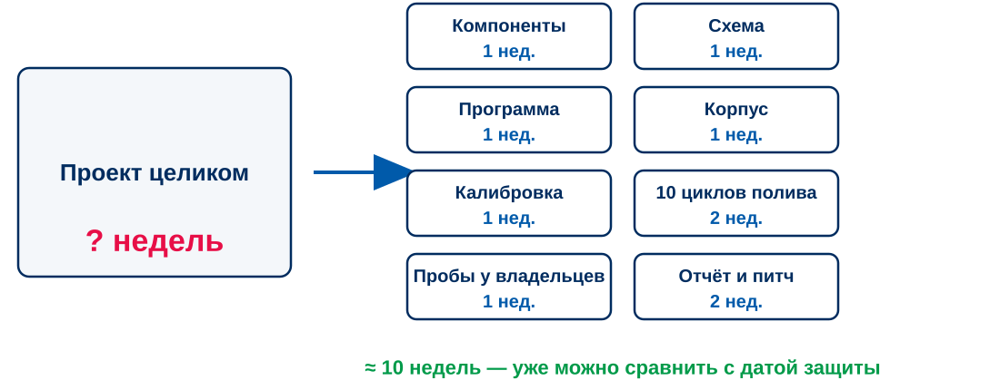
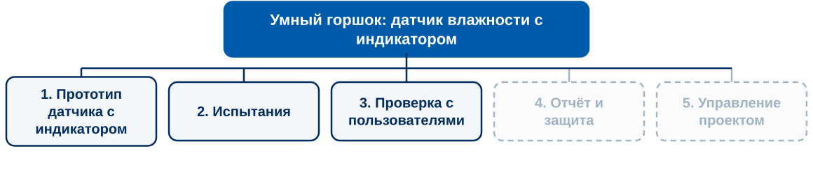
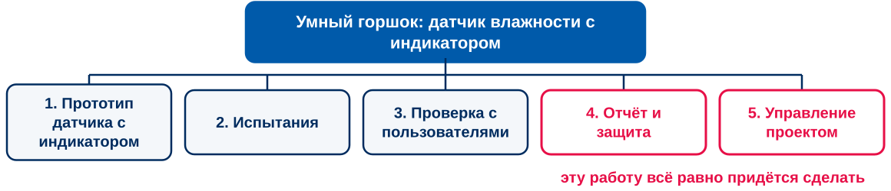
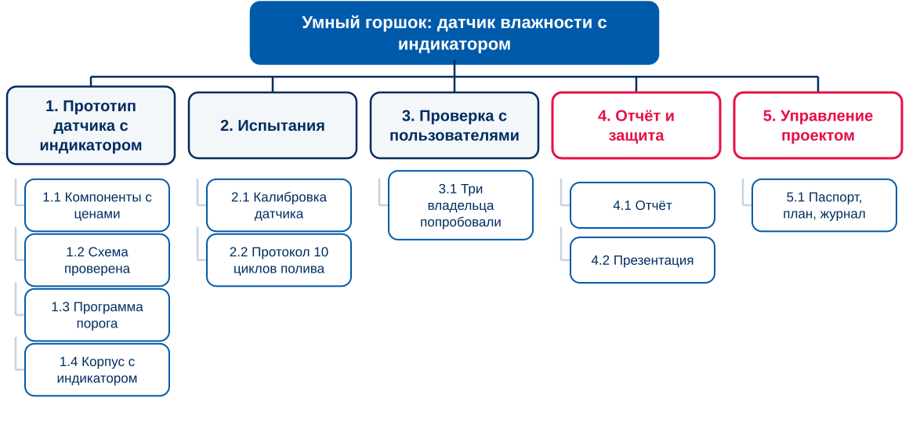
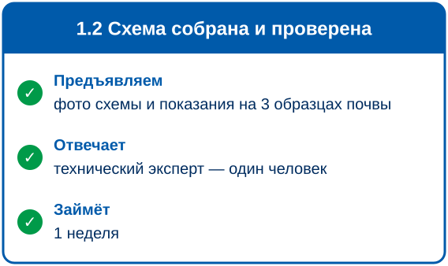
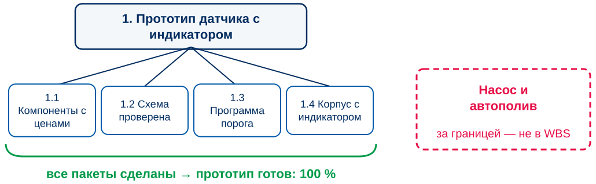
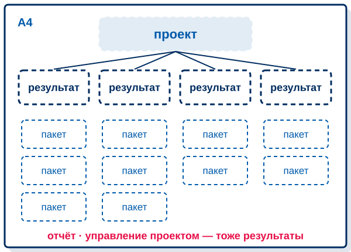
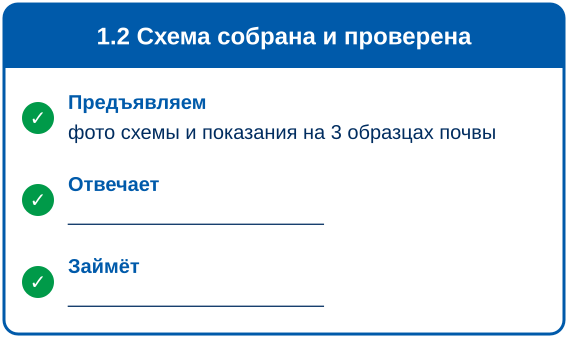

<!-- _class: lead -->
<!-- _paginate: false -->

# ЗАНЯТИЕ 6 · ПЛАНИРОВАНИЕ

## Из чего состоит проект: иерархическая структура работ

*К концу пары у каждой команды будет WBS своего проекта на листе А4: результаты и пакеты работ*

17 октября 2026

---

До плана — 2 недели · до чекпоинта — 5 недель · до защиты — 10 недель

26.09 · 03.10

Тема зафиксирована

Паспорт сдан

10 баллов

31.10

План собран

WBS, Ганта, смета, риски

10 баллов

21.11

Чекпоинт

Промежуточный результат

10 баллов

26.12

Питч-защита

Результат, отчёт, защита

50 баллов

Два зачётных теста по 10 баллов: «Инициация» — сегодня, «Планирование и контроль» — 28.11. Итого 100 баллов

<b>85–100</b>отлично

<b>70–84</b>хорошо

<b>55–69</b>удовлетворительно

<b>менее 55</b>не зачтено

Порог зачёта — 55 баллов. Всё, кроме защиты, даёт ровно 50: без защиты зачёта нет

---

# Тест 1 «Инициация»: 15 минут

Телефоны и конспекты убраны. Задания 1–14 — обведите одну букву, 15–17 — по инструкции в задании, 18–20 — коротко письменно.

- Подпишите лист: фамилия, группа, команда
- За 3 минуты до конца предупрежу
- Ответы разберём на одной из следующих пар

■ СТОП · 15 МИНУТ — Тест 1

---

# Одна цитата от команды: что она поменяла в вашем дереве проблем

<table class="contour">
<tr><th class="w45">Что сказал человек — дословно</th><th>Что поменялось в дереве проблем</th></tr>
<tr><td>например: «Поливаю по воскресеньям, а летом он к среде уже сухой»</td><td>например: дописали причину — полив по расписанию не учитывает жару</td></tr>
<tr><td></td><td></td></tr>
<tr><td></td><td></td></tr>
</table>

Подтвердилось, дописали новую причину или убрали лишнюю — любой ответ годится. «Ничего не поменялось» тоже ответ, если вы его проверили.

■ СТОП · 8 МИНУТ — по одной цитате от команды

---

<!-- _class: v2 dark hook -->

# Сколько времени займёт проект умного горшка?

---

# Пока проект целиком, срок назвать нельзя: его складывают из частей

---

# Иерархическая структура работ раскладывает выбранное содержание на результаты

Иерархическая структура работ (WBS, work breakdown structure) — разложение всей работы, которую команда должна выполнить, чтобы получить результаты проекта.

PMBOK Guide, PMI

Цель на дереве целей — состояние: «влажность видна». Элемент WBS — то, что предъявим: «прототип датчика с индикатором».

---

# Сверху проект, под ним — крупные результаты

Для каждой выбранной ветви дерева целей спросите: что мы предъявим, чтобы эта цель была достигнута? Называйте результат существительным.

---

# Отчёт и управление проектом тоже результаты, о них забывают первыми

Паспорт, план, журнал, отчёт и презентация займут время в любом случае. Если их нет в WBS, их нет и в сроке.

---

# Под каждым результатом — пакеты работ

---

# Пакет работ готов, когда понятно, что предъявить, кто отвечает и сколько это займёт

Пакет работ — работа на нижнем уровне WBS, для которой можно оценить срок и стоимость и за которой можно следить.

PMBOK Guide, PMI

Если один человек не сделает пакет за две недели, разложите его дальше. Если пакет делается за час, объедините его с соседним.

---

# Правило 100 %: в WBS вся работа проекта и ничего сверх неё

Две проверки. Если все пакеты под результатом сделаны, готов ли результат? Нет ли в WBS того, что вы записали в границы?

---

# Если разложить работу по людям, результат теряется

| Разложено по людям | Разложено по результатам |
|---|---|
| Вася: схема и пайка | 1. Прототип датчика с индикатором |
| Петя: программа | 2. Испытания: калибровка, 10 циклов полива |
| Маша: «всё остальное» | 3. Проверка с пользователями |
| Катя: презентация | 4. Отчёт и защита · 5. Управление проектом |

По левой колонке не видно, что получится и что забыто. Сначала результаты и пакеты, потом у каждого пакета появляется ответственный.

---

# Постройте WBS своего проекта на листе А4

<ol>
<li><b>10 мин.</b> Проект и 3–5 крупных результатов из выбранных ветвей дерева целей</li>
<li><b>15 мин.</b> Пакеты работ под каждым результатом, с номерами</li>
<li><b>5 мин.</b> Проверка: правило 100 %, отчёт и управление проектом на месте</li>
</ol>

Берите лист с деревом целей: WBS строится из его выбранных ветвей.

■ СТОП · 30 МИНУТ — WBS на листе А4

---

# Проверьте WBS соседней команды по четырём вопросам

1. Все выбранные ветви дерева целей есть в WBS, а того, что записано в границах, нет?
2. Есть отчёт с защитой и управление проектом?
3. Каждый элемент — результат, который можно предъявить, а не действие?
4. Каждый пакет можно поручить одному человеку?

По этим же вопросам WBS проверяется в сводном плане на вехе «План собран». Найденное соседями — исправьте сегодня, на своём листе.

■ СТОП · 5 МИНУТ — обмен листами

---

# К следующему занятию — ответственный и срок для каждого пакета

<ul>
<li>Доведите WBS до конца: все результаты, все пакеты, номера</li>
<li>Впишите в каждый пакет <b>одного ответственного</b> и <b>оценку длительности</b> в днях или неделях</li>
<li>Лист А4 принесите с собой: на следующей паре из пакетов строим диаграмму Ганта</li>
</ul>

