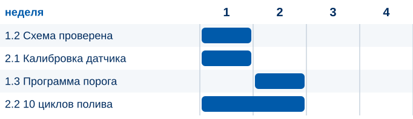
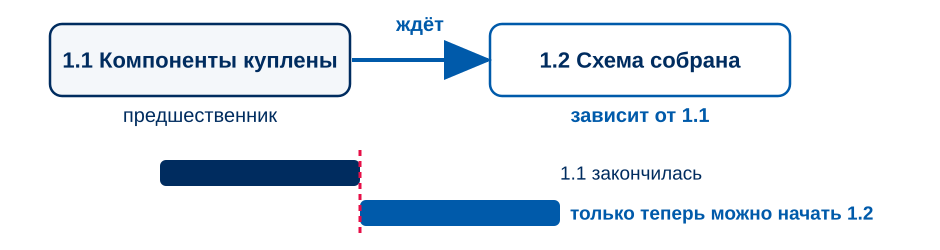
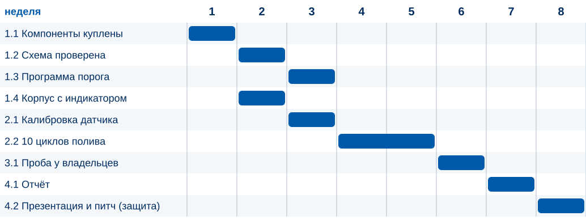
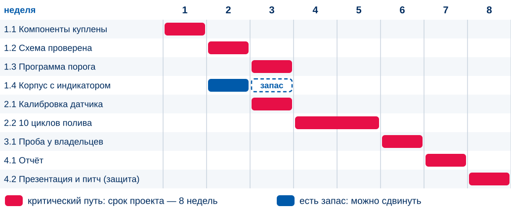
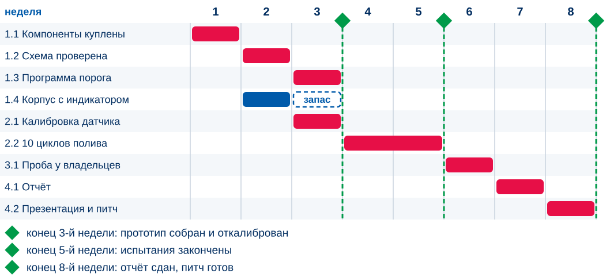
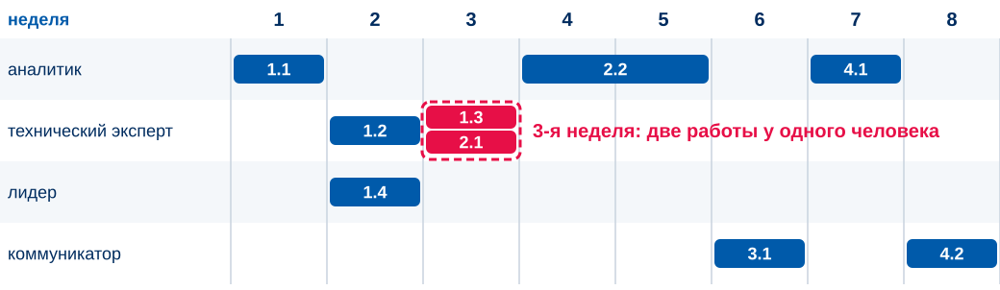
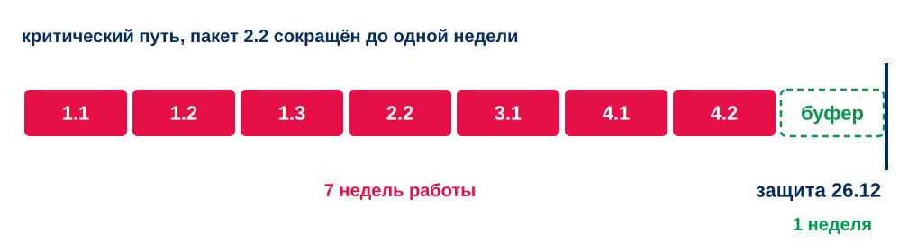
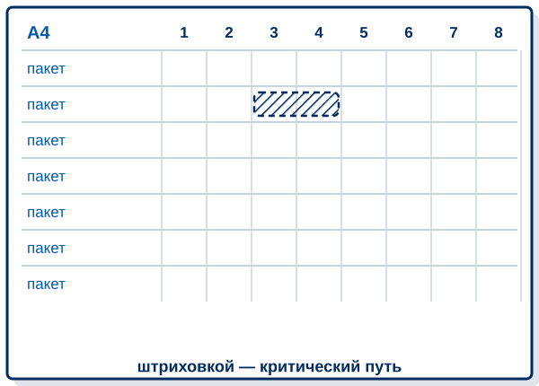

<!-- _class: lead -->
<!-- _paginate: false -->

# ЗАНЯТИЕ 7 · ПЛАНИРОВАНИЕ

## Когда что делаем: зависимости, критический путь и диаграмма Ганта

*К концу пары у каждой команды будет диаграмма Ганта своего проекта и срок, сверенный с датой защиты*

24 октября 2026

---

До плана — 1 неделя · до чекпоинта (контрольной точки) — 4 недели · до защиты — 9 недель

26.09 · 03.10

Тема зафиксирована

Паспорт сдан

10 баллов

31.10

План собран

WBS, Ганта, смета, риски

10 баллов

21.11

Чекпоинт (контрольная точка)

Промежуточный результат

10 баллов

26.12

Питч-защита

Результат, отчёт, защита

50 баллов

Два зачётных теста по 10 баллов: «Инициация» — написан, «Планирование и контроль» — 28.11. Итого 100 баллов

<b>85–100</b>отлично

<b>70–84</b>хорошо

<b>55–69</b>удовлетворительно

<b>менее 55</b>не зачтено

Порог зачёта — 55 баллов. Всё, кроме защиты, даёт ровно 50: без защиты зачёта нет

---

<!-- _class: v2 dark hook -->

# Найдите ошибку в графике

Что не так с этим графиком умного горшка?

---

# Диаграмма Ганта

Диаграмма Ганта — столбчатая диаграмма расписания: каждая работа показана отрезком на шкале времени, длина отрезка равна длительности.

PMBOK Guide, PMI

Все оценки пакетов горшка в сумме дают 10 недель. Сколько займёт проект на самом деле, покажет порядок работ.

---

# Зависимость между работами

Работа ждёт другую, когда без её результата не начать.

Вопрос к каждому пакету: что должно быть готово, чтобы можно было начать? Записывайте только прямых предшественников.

---

# Зависимости пакетов умного горшка

Что должно быть готово до начала каждого пакета?

<table class="contour">
<tr><th>Пакет</th><th class="w22">Недель</th><th class="w45">Зависит от</th></tr>
<tr><td>1.1 Компоненты куплены</td><td>1</td><td>например: ничего, можно начинать сразу</td></tr>
<tr><td>1.2 Схема собрана и проверена</td><td>1</td><td></td></tr>
<tr><td>1.3 Программа порога</td><td>1</td><td></td></tr>
<tr><td>1.4 Корпус с индикатором</td><td>1</td><td></td></tr>
<tr><td>2.1 Калибровка датчика</td><td>1</td><td></td></tr>
<tr><td>2.2 Десять циклов полива</td><td>2</td><td></td></tr>
<tr><td>3.1 Проба у владельцев растений</td><td>1</td><td></td></tr>
<tr><td>4.1 Отчёт · 4.2 Презентация и питч (защита)</td><td>1 · 1</td><td></td></tr>
</table>

■ СТОП · 4 МИНУТЫ — зависимости горшка

---

# Расстановка пакетов по неделям

Пакет стартует после самого позднего предшественника.

---

# Критический путь

Критический путь — самая длинная по времени последовательность связанных работ от начала проекта до его окончания. Она определяет минимально возможный срок.

PMBOK Guide, PMI

---

# Милстоуны (вехи)

Милстоун (веха) — момент, когда виден результат. Длительности у него нет.

---

# Нагрузка по людям

Диаграмма не знает, что технический эксперт один.

Проверьте каждую неделю по каждому человеку: два параллельных пакета у одного участника на деле пойдут по очереди.

---

# Рычаги при нехватке срока

Если срок не помещается до защиты, у команды три рычага.

| Рычаг | Что делаем | Чем платим |
|---|---|---|
| Содержание | Убираем или сокращаем пакет, записываем в границы | Меньше результата |
| Время | Пересматриваем оценку, только если узнали что-то новое | Риск, что оценка ошибочна |
| Ресурсы | Передаём пакет свободному участнику | Нагрузка на человека |

Это те же три вершины железного треугольника из вводной лекции. Сдвинули одну — пересчитайте остальные.

---

# Буфер (резерв времени)

Один буфер ставят в конце критического пути.

Запас, заложенный в каждый пакет, расходуется раньше, чем нужен. Буфер в конце виден всем и расходуется осознанно.

---

# Практика: диаграмма Ганта своего проекта

<ol>
<li><b>10 мин.</b> Для каждого пакета запишите зависимости</li>
<li><b>15 мин.</b> Расставьте пакеты по неделям, найдите критический путь и заштрихуйте его</li>
<li><b>10 мин.</b> Проверьте нагрузку по людям и отсчитайте срок назад от защиты</li>
</ol>

Берите WBS (иерархическую структуру работ) с оценками и ответственными. Бланк с сеткой недель или своя таблица — на ваш выбор.

■ СТОП · 35 МИНУТ — диаграмма Ганта на бланке

---

# Проверка диаграммы соседней команды

Четыре вопроса.

1. Каждый пакет из WBS есть в диаграмме, и лишних нет?
2. У каждого зависимого пакета записан предшественник, и без него начать действительно нельзя?
3. Критический путь выделен, и его длина совпадает со сроком проекта?
4. Нет недель, в которых у одного человека два параллельных пакета?

Срок проекта сверьте с защитой: помещается с запасом, впритык или не помещается. Последние два случая требуют решения команды.

■ СТОП · 8 МИНУТ — обмен листами

---

# Домашнее задание: риски и потребности пакетов

<ul>
<li>Доведите диаграмму: поправьте по замечаниям соседей, впишите срок проекта и решение, если он не помещается до защиты</li>
<li>Для каждого пакета на критическом пути — одна фраза: <b>что может пойти не так</b></li>
<li>Для каждого пакета — что нужно, чтобы его сделать: часы участников и материалы</li>
</ul>

