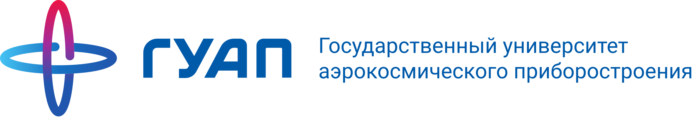
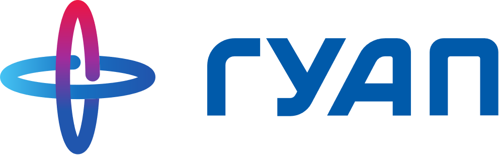
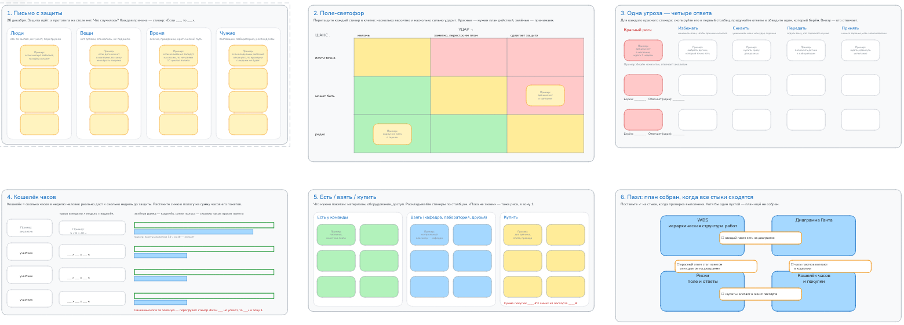
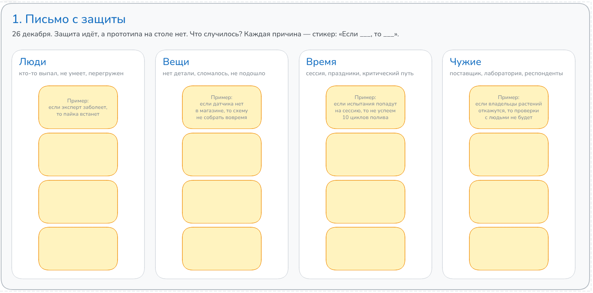
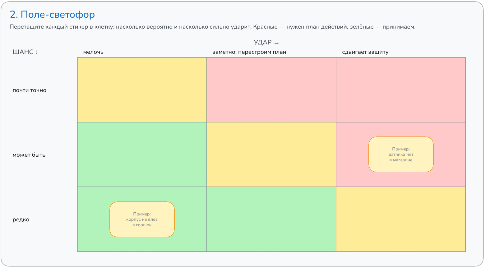
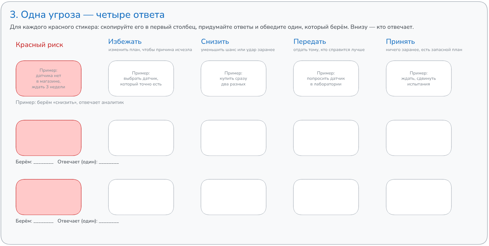
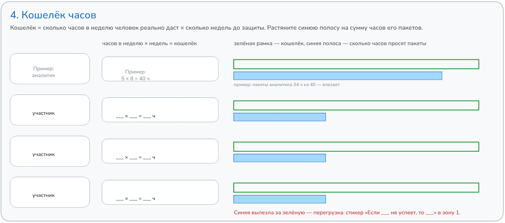
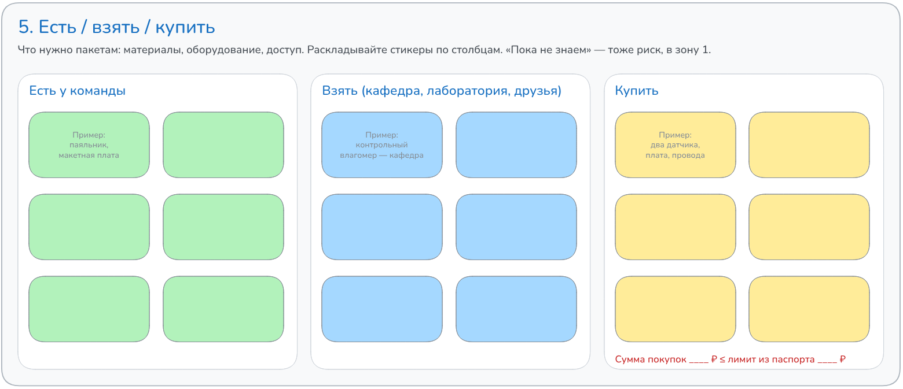
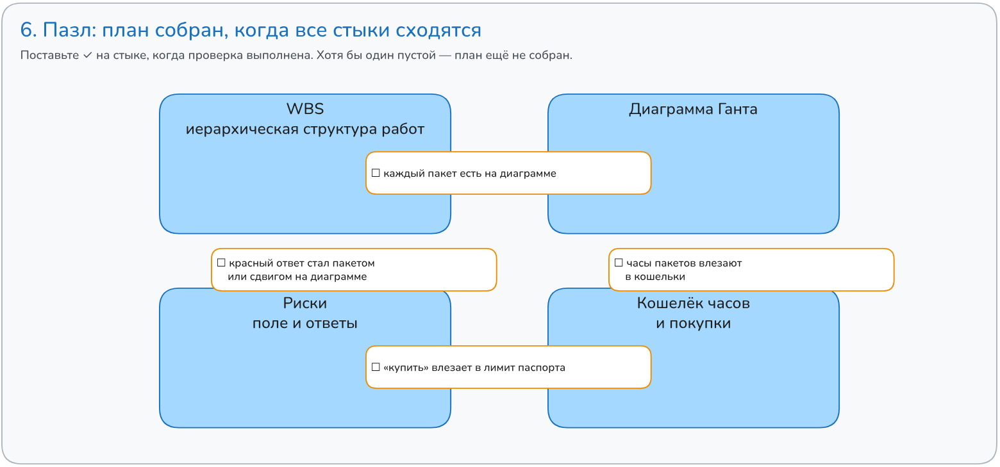

<!-- _class: lead -->
<!-- _paginate: false -->

# ЗАНЯТИЕ 8 · ПЛАНИРОВАНИЕ

## Риски и ресурсы проекта: работа на доске команды

*К концу пары у команды на доске — риски с ответами, кошелёк часов и список покупок; к следующему занятию — сводный план*

31 октября 2026

---

План: собираем сегодня, сдаём к следующему занятию · до защиты — 8 недель

26.09 · 03.10

Тема зафиксирована

Паспорт сдан

10 баллов

31.10 · 07.11

План собран

WBS (структура работ), Ганта, риски, ресурсы

10 баллов

21.11

Чекпоинт (контрольная точка)

Промежуточный результат

10 баллов

26.12

Питч-защита (выступление)

Результат, отчёт, защита

50 баллов

Два зачётных теста по 10 баллов: «Инициация» — написан, «Планирование и контроль» — 28.11. Итого 100 баллов

<b>85–100</b>отлично

<b>70–84</b>хорошо

<b>55–69</b>удовлетворительно

<b>менее 55</b>не зачтено

Порог зачёта — 55 баллов. Всё, кроме защиты, даёт ровно 50: без защиты зачёта нет

---

<!-- _class: v2 dark hook -->

# Письмо с защиты

26 декабря. Защита идёт, а прототипа на столе нет. Что случилось?

Две минуты: каждая команда записывает три причины. Это и будут ваши первые риски.

---

# Риск

То, что может случиться — а может и не случиться — и тогда помешает проекту.

Риск — неопределённое событие или условие, наступление которого влияет на цели проекта.

PMBOK Guide, PMI

<b>Записываем одной строкой:</b>

Если ___, то ___.

<b>Пример горшка:</b> если датчика нет в магазине и везти три недели, то схему не собрать вовремя и сдвинется весь план.

«Не хватит времени» — не риск, а общее беспокойство. Риск — конкретное событие и его последствие.

---

# Доска команды

Сегодня работаем на онлайн-доске Excalidraw: шесть зон по порядку, от рисков к готовому плану.

<ul>
<li>Откройте ссылку своей команды — регистрация не нужна, работаете вместе</li>
<li>Двойной щелчок по стикеру — писать; Ctrl+D — копия; стикеры можно двигать</li>
<li>Серые «Пример:» — про умный горшок: сотрите и впишите своё</li>
<li>В конце: Меню → Export image → PNG (картинка) — это часть сдачи</li>
</ul>

---

# Зона 1 · Письмо с защиты

Ищем риски в четырёх карманах: люди, вещи, время, чужие.

<b>Что делаем</b>

<ul>
<li>Каждую причину из письма — на стикер: «Если ___, то ___»</li>
<li>Разложите по карманам; пустой карман — подумайте ещё</li>
<li>Хватит пяти-семи стикеров</li>
</ul>

Зачем: план без рисков работает только на бумаге. Четыре кармана подсказывают, где искать.

---

# Зона 2 · Поле-светофор

Оцениваем каждый риск двумя словами: шанс и удар.

<b>Что делаем</b>

<ul>
<li>Перетащите каждый стикер в клетку</li>
<li>Шанс: редко, может быть, почти точно</li>
<li>Удар: мелочь, заметно, сдвигает защиту</li>
</ul>

Зачем: сразу видно, чем заниматься. Красные — нужен план действий, зелёные — принимаем.

---

# Зона 3 · Одна угроза — четыре ответа

Для каждого красного риска выбираем, что делаем заранее.

<b>Что делаем</b>

<ul>
<li>Скопируйте красный стикер в первый столбец</li>
<li>Придумайте четыре ответа: избежать, снизить, передать, принять</li>
<li>Выберите один и впишите, кто отвечает</li>
</ul>

Зачем: ответ на риск — это выбор, а не формула. Выбранный ответ становится делом в плане.

---

# Зона 4 · Кошелёк часов

Проверяем, хватит ли людям времени на свои пакеты работ.

<b>Что делаем</b>

<ul>
<li>Кошелёк = часов в неделю × недель до защиты</li>
<li>Синюю полосу растяните на сумму часов пакетов человека</li>
<li>Полоса вылезла за рамку — новый риск в зону 1</li>
</ul>

Зачем: диаграмма Ганта верна, только если у людей есть время. Перегрузку видно сразу.

---

# Зона 5 · Есть / взять / купить

Проверяем, хватит ли проекту вещей и доступа.

<b>Что делаем</b>

<ul>
<li>Что нужно пакетам: материалы, оборудование, доступ</li>
<li>Разложите стикеры по трём столбцам</li>
<li>Сумма покупок — не больше лимита из паспорта</li>
</ul>

Зачем: это смета (список нужного) без бухгалтерии. «Пока не знаем» — тоже риск, в зону 1.

---

# Зона 6 · Пазл сборки плана

План собран, когда все четыре части стыкуются.

<b>Что делаем</b>

<ul>
<li>Пройдите четыре стыка между частями плана</li>
<li>На выполненной проверке поставьте ✓</li>
<li>Пустой стык — найдите, какая часть расходится, и поправьте</li>
</ul>

Зачем: части плана писали в разное время. Пазл ловит расхождения до сдачи.

---

# Критерии вехи «План собран»

По этим пунктам проверяется комплект — 10 баллов.

| Что проверяем | Где смотреть |
|---|---|
| Все пакеты из WBS (структуры работ) есть на диаграмме Ганта | бланки занятий 6 и 7 |
| Срок проекта помещается до защиты, есть буфер (резерв времени) | диаграмма Ганта |
| Пять-семь рисков, у красных — выбранный ответ и ответственный | доска, зоны 1–3 |
| Часы пакетов влезают в кошельки, покупки — в лимит паспорта | доска, зоны 4–5 |
| Все четыре стыка пазла отмечены | доска, зона 6 |

---

# Сдача плана — к следующему занятию

<ul>
<li>Доделайте доску дома: все шесть зон</li>
<li>Сохраните доску картинкой: Меню → Export image → PNG</li>
<li>Сдайте комплект: бланк WBS, бланк Ганта и PNG доски</li>
</ul>

Если ответ на красный риск — новое дело, впишите его пакетом в WBS и на диаграмму Ганта до сдачи.

