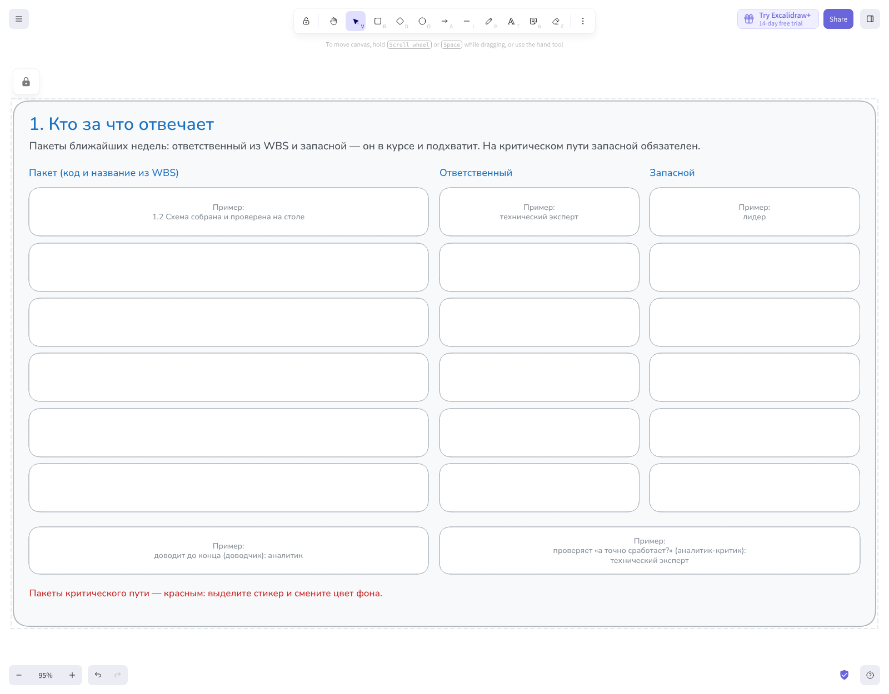
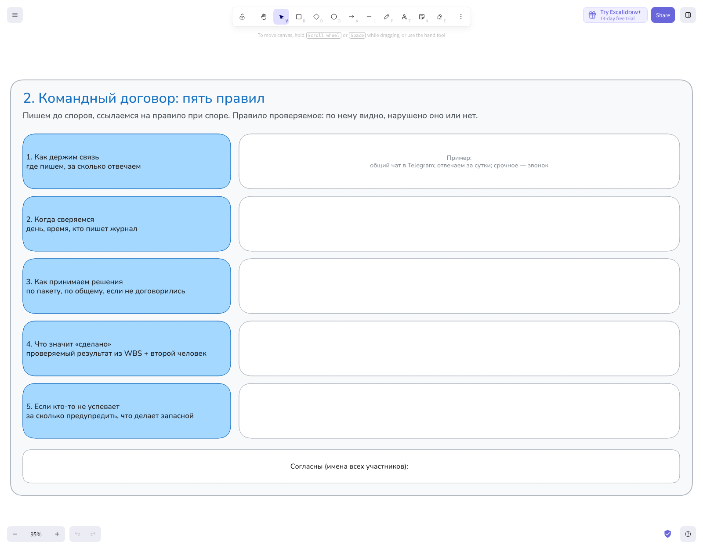
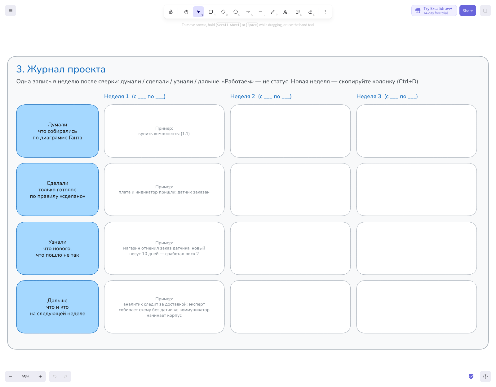
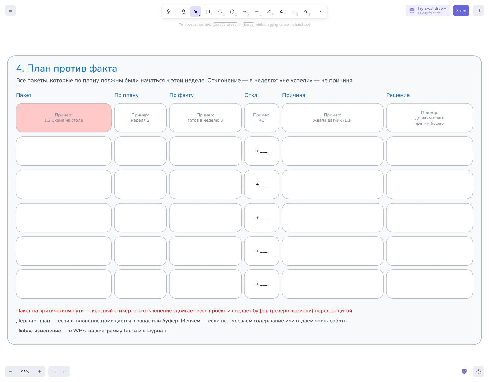
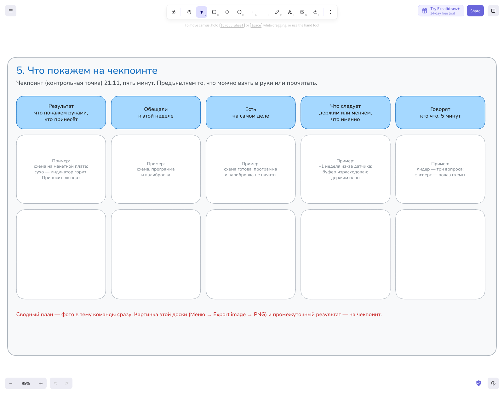

<!-- _class: lead -->
<!-- _paginate: false -->

# ЗАНЯТИЕ 9 · ИСПОЛНЕНИЕ

## Команда и исполнение: от плана к делу

*Самостоятельная работа по методическим указаниям — на бланке или на доске команды. К чекпоинту (контрольной точке) — результат и таблица «план против факта»*

14 ноября 2026

---

Чекпоинт — через неделю · до защиты — 6 недель

26.09 · 03.10

Тема зафиксирована

Паспорт сдан

10 баллов

сдать сейчас

План собран

Фото бланков — в тему команды

10 баллов

21.11

Чекпоинт (контрольная точка)

Промежуточный результат, план против факта

10 баллов

26.12

Питч-защита (выступление)

Результат, отчёт, защита

50 баллов

Два зачётных теста по 10 баллов: «Инициация» — написан, «Планирование и контроль» — 28.11. Итого 100 баллов

<b>85–100</b>отлично

<b>70–84</b>хорошо

<b>55–69</b>удовлетворительно

<b>менее 55</b>не зачтено

Порог зачёта — 55 баллов. Всё, кроме защиты, даёт ровно 50: без защиты зачёта нет

---

<!-- _class: v2 dark hook -->

# «Работаю»

Неделя после плана. Лидер пишет в чат команды: «Как дела?» Ответы: «работаю», «почти готово», «скоро скину».

Сколько пакетов готово? По этим ответам не узнать. Эта тема — о том, как сделать, чтобы было видно.

---

# Исполнение

План есть — начинается работа. Пять фаз жизненного цикла из вводной лекции:

инициация → планирование → <b>исполнение</b> → мониторинг и контроль → завершение

<b>Новые трудности:</b>

<ul>
<li>работают люди, а не бумага — нужно договориться, как</li>
<li>жизнь расходится с планом — нужно вовремя заметить</li>
</ul>

Главное правило: начинать вовремя. Отложенный пакет на критическом пути сдвигает всё, что идёт за ним.

---

# Стадии развития команды

Шторм — норма: он почти всегда приходится на начало исполнения.

| Стадия | Что происходит |
|---|---|
| Формирование | все вежливы, роли неясны |
| Шторм | разногласия: кто главный, кто сколько делает |
| Нормирование | команда договаривается о правилах |
| Функционирование | работа без выяснения отношений |

Tuckman, 1965; пятая стадия — завершение: Tuckman &amp; Jensen, 1977

---

# Роли в команде

Успех команды зависит от набора ролей, а не только от ума участников.

| Группа | Роли |
|---|---|
| Роли мысли | генератор идей, аналитик-критик, специалист |
| Роли действия | мотиватор, реализатор, доводчик |
| Роли людей | координатор, душа команды, добытчик ресурсов |

В команде из 3–4 человек каждый закрывает две-три роли. Чаще всего пустует доводчик — тот, кто не даёт бросить работу на 90 %.

Belbin, 1981

---

# Зона 1 · Кто за что отвечает

У каждого пакета ближайших недель — ответственный и запасной.

<ul>
<li>Выпишите пакеты из WBS (структуры работ), начиная с ближайших недель</li>
<li>Ответственный — из WBS; запасной в курсе и подхватит</li>
<li>Пакеты критического пути — красные: у них запасной обязателен</li>
<li>Назначьте доводчика и аналитика-критика</li>
</ul>

Зачем: без запасного пакет критического пути держится на одном человеке.

---

# Зона 2 · Командный договор

Пять правил, которые команда пишет до споров.

<ul>
<li>Связь: где пишем и за сколько отвечаем</li>
<li>Сверка: день, время, кто пишет журнал</li>
<li>Решения: кто решает по пакету, кто по общему</li>
<li>«Сделано»: результат из WBS, его видел второй человек</li>
<li>Если не успеваю: за сколько предупредить, что делает запасной</li>
</ul>

Зачем: при споре обсуждаем правило, а не человека. Правило проверяемое: видно, нарушено или нет.

---

# Зона 3 · Журнал проекта

Одна запись в неделю после сверки.

<ul>
<li>Думали — что собирались по диаграмме Ганта</li>
<li>Сделали — только готовое по правилу «сделано»</li>
<li>Узнали — что нового, что пошло не так</li>
<li>Дальше — что и кто на следующей неделе</li>
</ul>

Зачем: на чекпоинте и на защите журнал показывает, что команда работала все недели.

---

# Зона 4 · План против факта

Главная таблица чекпоинта: отклонение и его причина.

<ul>
<li>Выпишите пакеты, которые по плану должны были начаться к этой неделе</li>
<li>По плану, по факту, отклонение в неделях</li>
<li>Причина одной фразой: «не успели» — не причина</li>
<li>На критическом пути отклонение сдвигает весь проект</li>
</ul>

Зачем: по причине видно, повторится ли отклонение и что с ним делать.

---

# Зона 5 · Что покажем на чекпоинте

Пять минут: результат в руках и три ответа.

<ul>
<li>Результат: что покажем руками и кто принесёт</li>
<li>Обещали: что было к этой неделе по плану</li>
<li>Есть: что на самом деле</li>
<li>Что следует: держим план или меняем, что именно</li>
</ul>

Зачем: веха — это то, что предъявляем, а не рассказ о том, как продвигается.

---

# Держим план или меняем

<b>Держим</b>, если отклонение помещается в запас пакета или в буфер (резерв времени) перед защитой. Записываем отклонение и причину в журнал.

<b>Меняем</b>, если не помещается. Защита не двигается, поэтому: урезаем содержание или отдаём часть работы тому, у кого есть часы.

<b>Как менять:</b> решает команда на сверке → правим WBS, диаграмму Ганта, кошельки, а если меняется результат — паспорт → запись в журнал → результат из паспорта изменился — сообщаем преподавателю.

Пример горшка: датчик везли 10 дней, критический путь сдвинулся на неделю, буфер израсходован. План держим, но заранее решили, что урежем при следующем сдвиге.

---

# Критерии чекпоинта (контрольной точки)

По этим пунктам проверяется веха 21.11 — 10 баллов.

| Что проверяем | Где смотреть |
|---|---|
| Есть промежуточный результат, который можно показать | в руках на чекпоинте |
| В таблице все пакеты, которые должны были начаться; у каждого отклонения — причина | зона 4 |
| Есть решение: держим план или меняем, и что именно | зоны 4–5 |
| Журнал ведётся с начала работы, по записи на неделю | зона 3 |
| Командный договор написан и подписан всеми | зона 2 |

---

# Что сдать и когда

<b>Сразу:</b> сводный план — фото бланков WBS, Ганта и листа рисков (или картинка доски) в тему своей команды в Telegram.

<b>К чекпоинту 21.11:</b> лист этого занятия или картинка доски, промежуточный результат — в руках.

<ul>
<li>Указания — с примером горшка по каждой зоне</li>
<li>Бланк А4 или доска команды — ссылка в теме команды</li>
<li>Таблица «план / факт» и журнал — Google-таблица, сделайте копию</li>
</ul>

